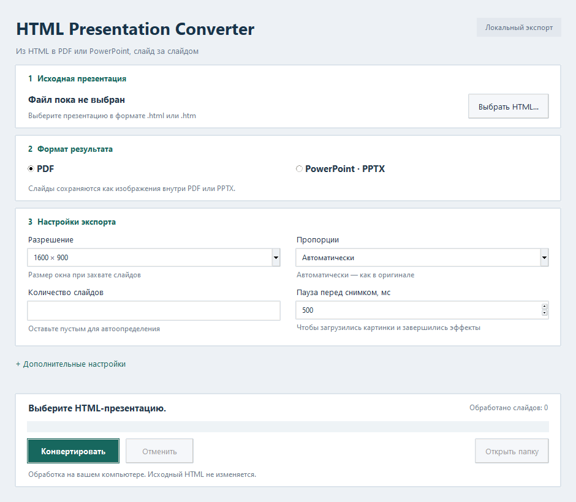

# HTML Presentation Converter

Учебная программа для Windows: выбираете HTML-презентацию и получаете PDF либо PPTX, где каждому исходному слайду соответствует отдельная страница или слайд PowerPoint. Обработка выполняется на вашем компьютере. Нейросети, облачные API и платные сервисы не используются.

Экспорт растровый: внешний вид сохраняется в виде PNG, текст в PowerPoint не редактируется. Поддерживаются описанные ниже структуры презентаций; универсальная поддержка любых HTML-файлов не заявляется.



## Быстрый запуск

1. Установите **Python 3.11+** с [python.org](https://www.python.org/downloads/windows/). В установщике включите **Tcl/Tk and IDLE**, **Python Launcher** и **Add Python to PATH**.
2. Установите **Node.js LTS 22+** с [nodejs.org](https://nodejs.org/), вместе с npm.
3. Установите обычный **Google Chrome** с [официального сайта](https://www.google.com/chrome/).
4. Скачайте проект и распакуйте в любую доступную папку. Сохраните всю структуру каталогов.
5. Дважды щёлкните **setup.bat**. Для загрузки библиотек нужен интернет. Скрипт создаст локальные `.venv`, `node_modules`, `.cache` и `tmp`.
6. Дважды щёлкните **run.bat**.

Ни setup.bat, ни программа не устанавливают системные приложения и не скачивают отдельный Chromium. Для Playwright используется официальный канал `chrome` с `headless: true` и включённой песочницей браузера. Личный профиль Chrome не открывается. Программа проверяет не только запуск процесса, но и создание вкладки.

Если Chrome отсутствует или не запускается, приложение показывает понятную ошибку и предлагает открыть официальный сайт. Путь к `chrome.exe` можно выбрать вручную в расширенных настройках; это необязательный запасной вариант. Установка браузера автоматически не запускается.

Локальное окружение Python и Node-зависимости создаются при установке. Не переносите `.venv` и `node_modules` между компьютерами: на новом компьютере запускайте setup.bat заново.

## Использование

1. Нажмите **Выбрать HTML** и укажите `.html` или `.htm` с любого доступного диска.
2. Выберите PDF или PPTX.
3. Оставьте 1600 × 900 и автоматическое определение пропорций либо выберите другие настройки.
4. Нажмите **Конвертировать**, выберите путь результата.
5. Следите за числом обработанных слайдов. После завершения доступна кнопка **Открыть папку**.

Кнопка **Отменить** прекращает обработку. Закрытие окна во время работы тоже запускает отмену: приложение ждёт закрытия своего процесса Node.js и браузера, удаляет временные изображения. Итоговый файл появляется только после успешной сборки. При ошибке или отмене существующий результат сохраняется.

Разрешение задаёт размер браузерного окна. Элементы с фиксированной геометрией, например 960 × 720, захватываются в их собственном размере: приложение не меняет исходную CSS-вёрстку. Автоматический формат результата берётся из области первого слайда; для Reveal.js учитывается конфигурация фреймворка. Принудительный выбор 16:9 или 4:3 задаёт размер страницы результата, добавляя поля при необходимости. Изображение не растягивается с нарушением пропорций.

## Автоматическое определение и навигация

**Reveal.js.** Проверяется глобальный `Reveal`, ожидается готовность фреймворка. Используются `getSlides()`, `getIndices()`, `slide(h, v, f)`, `loadSlide()` и `navigateFragment()`. Горизонтальные и вложенные вертикальные слайды сохраняются в порядке фреймворка. На каждой странице — окончательное состояние всех фрагментов. Кнопки и индикаторы самого Reveal скрываются. Отложенные изображения проверяются на текущем слайде, фон входит в захват.

**Обычные HTML-слайды.** Проверяются селекторы `[data-slide]`, `.slide`, `.presentation-slide`, `.slide-page`, `.slides > section`, `main > section`. Если все элементы видны и не перекрываются, каждый захватывается отдельно. Если слайды скрываются или перекрываются, проверяются видимость, CSS-классы `active/present/current`, положение и элемент под точкой в центре. Программа отправляет клавишу и проверяет фактический переход к следующему DOM-элементу. Если документ открыт не с первого слайда, пробует Home; если это не помогает, останавливается с пояснением.

Вложенные неоднозначные селекторы и неизвестная структура требуют ручной настройки. Программа не выдаёт один случайный кадр за успешную конвертацию.

## Ручные настройки

Раскройте **Дополнительные настройки**. Они прокручиваются в основной области окна; кнопки конвертации и прогресс остаются видимыми внизу. Раскрытие блока не меняет размер окна.

| Поле | Что указать |
| --- | --- |
| CSS-селектор слайдов | Например `.my-slide`: отдельный DOM-элемент на каждый слайд |
| Слайдов | Пусто — авто; иначе точное число от 1 до 500 |
| Клавиша вперёд | `ArrowRight`, `Space`, `PageDown`, `Enter` или комбинация Playwright, например `Control+ArrowRight` |
| Пауза перед снимком | Ожидание после перехода, чтобы загрузились картинки и завершились эффекты. От 0 до 10000 мс; обычно 500, для медленных презентаций 1000–2000 |
| Область захвата | Необязательный селектор одного контейнера, например `#stage`, без окружающих кнопок |

Если своя презентация перерисовывает один canvas или контейнер, **оставьте селектор слайдов пустым**, укажите количество и клавишу; при необходимости задайте область захвата. Документ должен начинаться с первого слайда. В этом режиме повторившийся PNG считается отсутствием перехода или циклом. Если несколько намеренно одинаковых слайдов представлены разными DOM-элементами, укажите их селектор: они будут сохранены все.

При структурном режиме ручное число должно совпадать с количеством найденных элементов. Навигация с пропущенным слайдом, циклом или отсутствием перехода завершится ошибкой. Для переключения по клику, нестандартного API без клавиатуры либо нескольких Reveal-экземпляров может понадобиться адаптация исходной презентации или отдельный адаптер программы.

## Ресурсы и изоляция

HTML открывается через временный HTTP-сервер на **127.0.0.1**, на случайном порту, с непредсказуемым токеном пути. Сервер обслуживает только выбранную папку и вложенные папки; не выдаёт содержимое через `..`, обратные слеши, абсолютные пути и ссылки за пределы папки. Каталоги не перечисляются. Оригинальные HTML, CSS, JS и изображения не изменяются.

Сохраняйте относительную структуру ресурсов рядом с HTML. Ссылки `../` за пределы папки HTML или `/assets/...` от корня сайта не поддерживаются: перенесите ресурсы внутрь папки и исправьте ссылки в своей копии презентации. Программа не получает доступ к другим папкам автоматически.

Внешние сетевые запросы по умолчанию блокируются, и конвертация объясняет, какие ресурсы недоступны. Для доверенных CDN-презентаций включите **Разрешить внешние HTTP/HTTPS-ресурсы** и подтвердите предупреждение. HTTP/HTTPS-запросы скриптов тоже разрешаются этим переключателем; используйте его осознанно. WebSocket, service worker, новые окна и загрузка файлов отключены. Ошибки загрузки CSS, JS, изображений, шрифтов и локальных fetch/XHR-данных препятствуют успешному экспорту.

Изоляция браузерного контекста отделяет cookies и профиль, но не делает произвольный вредоносный HTML безопасным. Открывайте известные вам презентации. Браузерные защитные механизмы программа не отключает.

## Роли технологий и структура

**Python** — главное приложение: Tkinter/ttk, выбор файлов, настройки, фоновый поток, контроль subprocess, отмена, проверка PNG, PDF через Pillow и PPTX через python-pptx. PDF собирается постранично, без удержания всех RGB-кадров в памяти.

**Node.js** — реальный отдельный процесс, запускающий установленный Chrome через Playwright, локальный HTTP-сервер и захват PNG. Без Node.js конвертация не выполняется.

**JavaScript** — анализ DOM и видимости, адаптеры Reveal/HTML/ручной навигации, проверка смены слайдов, ожидание шрифтов, изображений и окончания конечных CSS-анимаций. Снимок берётся с элемента презентации, без интерфейса Chrome.

```text
main.py                     GUI по умолчанию, CLI для автоматизации
converter/models.py         настройки и ошибки
converter/bridge.py         subprocess, JSONL, таймаут и отмена
converter/export.py         проверка PNG, PDF и PPTX
converter/gui.py            русский интерфейс Tkinter/ttk
renderer/cli.mjs            точка входа Node.js
renderer/capture.mjs        изолированный браузер и захват
renderer/adapters.mjs       анализ и навигация по слайдам
renderer/server.mjs         ограниченный loopback HTTP-сервер
examples/                   тестовые презентации и ресурсы
tests/                      unit/integration/GUI-тесты
tools/                      подготовка Reveal и проверка артефактов
docs/                       план и отчёт испытаний
setup.bat / run.bat          установка / запуск Windows
test.bat                    полная проверка разработчика
```

Обмен Python ↔ Node: Python пишет конфигурацию в JSON во временную папку проекта, запускает Node через `subprocess` и читает **JSON Lines** из stdout. Каждая строка — самостоятельное сообщение `status`, `detected`, `progress`, `diagnostic`, `result` или `error`. Результат содержит пути PNG, индексы, размеры и сведения о Chrome. stderr читается отдельно и ограничен по объёму. HTML-консоль не пишет необработанный текст в канал протокола. Отмена передаётся строкой `cancel` через stdin; если процесс не отвечает, завершается только созданное приложением дерево процессов.

## Проверка из командной строки

```bat
.venv\Scripts\python.exe main.py --check
.venv\Scripts\python.exe main.py examples\02-javascript.html result.pdf
.venv\Scripts\python.exe main.py examples\05-ratio.html result.pptx
.venv\Scripts\python.exe main.py custom.html result.pdf --slides 5 --next-key Space --capture-selector "#stage" --delay 1000
.venv\Scripts\python.exe main.py custom.html result.pdf --selector ".my-slide" --aspect 16:9
```

CLI может заменить указанный файл результата после успеха. При Ctrl+C выполняется отмена. Родительская папка результата должна существовать.

## Примеры и тесты

| Файл | Проверяемая возможность | Слайдов |
| --- | --- | ---: |
| 01-simple.html | Три последовательных статических раздела | 3 |
| 02-javascript.html | Переключение JavaScript + hidden/active | 3 |
| 03-animation.html | Конечное состояние CSS-анимаций | 3 |
| 04-resources.html | Локальные CSS, SVG, таблица, кириллица | 3 |
| 05-ratio.html | Фиксированные пропорции 4:3 | 3 |
| 06-reveal.html | Горизонтальные/вертикальные слайды и фрагменты | 4 |
| 07-fun-lab.html | Интерактивная презентация с шутками, мини-игрой, ползунком и конфетти | 9 |

**07-fun-lab.html** — один самостоятельный HTML-файл: откройте его двойным щелчком в браузере. Все стили и скрипты внутри, интернет не нужен. Навигация: стрелки, Space, Home/End; F — полный экран, O — обзор. На узком экране включается вертикальная компоновка. Конвертер захватывает все девять слайдов; интерактивные кнопки работают в оригинальном HTML.

Первые пять примеров работают сразу. Reveal-пример использует локальные ресурсы из необязательной зависимости разработки, не CDN. Для его подготовки и полного тестирования:

```bat
set PLAYWRIGHT_SKIP_BROWSER_DOWNLOAD=1
npm install --include=dev --ignore-scripts --no-audit --no-fund
.venv\Scripts\python.exe -m pip install -r requirements-dev.txt
.venv\Scripts\python.exe tools\prepare_reveal.py
test.bat
.venv\Scripts\python.exe tools\verify_examples.py
```

`verify_examples.py` экспортирует шесть примеров в оба формата, проверяет содержимое PDF/PPTX, сравнивает PNG внутри PPTX побайтово, отрисовывает PDF через PDFium и сравнивает пиксели с исходными кадрами. Результаты, contact-sheet и машинный отчёт находятся в игнорируемой `test-results`. pypdf и pypdfium2 нужны только разработчику. Версии Node-зависимостей фиксирует `pnpm-lock.yaml`; для воспроизводимой установки с pnpm используйте `pnpm install --frozen-lockfile --ignore-scripts`.

Результаты реального прогона и ограничения проверки перечислены в [docs/TEST_REPORT.md](docs/TEST_REPORT.md).

## Ограничения

- Текст в PDF не имеет отдельного текстового слоя; текст и объекты PPTX не редактируются.
- Видео, звук, бесконечные анимации, canvas/WebGL и динамические данные сохраняются статическим кадром. Универсального определения «окончательного» состояния JavaScript нет: иногда нужна большая задержка.
- Программа завершает конечные CSS-анимации и останавливает бесконечные; специфичные сценарии, завязанные на время, требуют проверки результата.
- Умышленно одноцветный слайд считается пустым и вызывает ошибку. Это сознательная защита от ошибочного захвата.
- Структурные слайды должны иметь определяемую область; неизвестные вложенные/перекрывающиеся структуры требуют точного селектора.
- Без DOM-идентичности два намеренно одинаковых кадра в ручном режиме неотличимы от цикла.
- Предел — 500 слайдов, таймаут операции по умолчанию 20 секунд. PDF записывается последовательно; при очень больших презентациях дополнительные каталоги PDF увеличивают размер и время записи.
- Недоступный шрифт заменяется браузером системным; это может менять вёрстку. Проверка fonts.ready гарантирует окончание загрузки, а не наличие отсутствующего шрифта.
- Сложные iframe, вход в аккаунты, содержимое личного профиля и загрузки через WebSocket не поддерживаются.
Перед публикацией проверьте список файлов: `git status --short`. Краткая инструкция: [загрузка на GitHub](docs/PUBLISHING.md).

Официальная документация: [Playwright: установленный Chrome](https://playwright.dev/docs/browsers#google-chrome--microsoft-edge), [Reveal.js API](https://revealjs.com/api/), [Pillow PDF](https://pillow.readthedocs.io/en/stable/handbook/image-file-formats.html#pdf), [python-pptx](https://python-pptx.readthedocs.io/).
